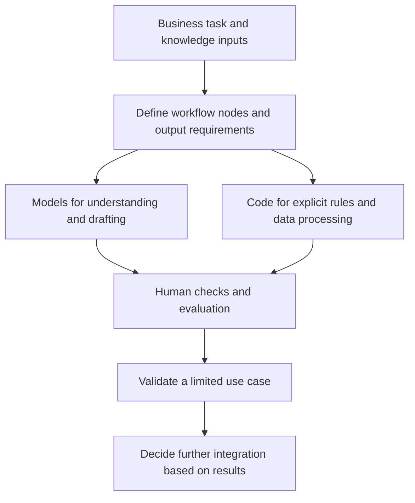

# Zhengye: Enterprise AI Use-Case Assessment and Technical Mentoring

**正晔网红财税：企业 AI 场景诊断与技术辅导**

**Contributor / 申请人：** Wang Zhaohua (Jiamu) / 王照华（甲木）

**My role / 本人角色：** AI use-case consultant, training-program designer and technical mentor / AI 场景顾问、培训方案设计者、技术指导者。

| Activity detail / 活动信息 | Content / 内容 |
| --- | --- |
| Needs consultation / 需求沟通 | 25 February 2026, approximately 51 minutes / 2026 年 2 月 25 日，约 51 分钟 |
| Program design / 培训设计 | Two-day, role-based AI curriculum / 两天岗位 AI 应用课程 |
| Audience / 服务对象 | Enterprise staff and the internal project lead / 企业员工与项目牵头人 |
| Service / 服务形式 | Enterprise AI consulting and technical mentoring / 企业 AI 咨询与技术辅导 |

## Activity description · English

I provided AI use-case assessment, training design and technical guidance for Zhengye's sales, content, client-service and delivery workflows. Through needs discussions, employee questionnaires and anonymized cases, I examined sales-knowledge reuse, recurring data collection and reporting, routine client replies and onboarding. I translated these needs into training cases and application paths. My guidance emphasized workflow decomposition, business knowledge and prompts, matching models or tools to tasks, and using deterministic code where appropriate. With the internal lead, I discussed existing agent demos, deployment choices and small-scale validation before further integration or investment. This helped frame business problems as technical tasks that could be tested progressively. These methods can inform AI ERP client-service and delivery workflows and Microsoft Foundry Agent tool use and evaluation.

## 活动说明 · 中文

我围绕正晔网红财税的销售、内容运营、客户服务与方案交付需求，开展 AI 场景诊断、培训方案设计和技术辅导。我通过需求沟通、员工问卷及脱敏业务案例，梳理销售经验难以复用、重复取数与汇报、客户常见问题答复和新人知识传递等任务，将其转化为培训案例与应用路径。技术指导重点是拆解工作流节点、组织业务知识与提示词、为不同任务匹配模型或工具，并明确哪些环节适合用确定性代码处理。我也与企业内部牵头人讨论现有智能体演示的问题、部署选型及小范围验证方法，建议先验证具体场景，再决定系统集成和进一步投入。我的工作帮助企业将业务问题表述为可以逐步验证的技术任务。这种知识沉淀、数据处理与工具编排思路，可为 AI ERP 的客户服务和交付流程，以及 Microsoft Foundry Agent 的工具调用与评估设计提供参考。

## My contribution · 个人贡献

- **Needs assessment / 需求诊断：** Connected recurring sales, content, reporting, client-service and onboarding tasks to AI applications. / 将销售、内容、汇报、客户服务与新人培养需求转化为 AI 场景。
- **Training design / 培训设计：** Organized questionnaire and anonymized-case inputs, designed a two-day curriculum and prepared learning materials. / 组织问卷与脱敏案例，设计两天课程并准备学习材料。
- **Technical mentoring / 技术辅导：** Guided workflow decomposition, prompt and knowledge organization, model/tool selection, deterministic code and small-scale validation. / 指导工作流拆分、提示词与知识组织、模型工具选择、确定性代码及小范围验证。

## Supporting materials · 配套资料

| Attachment / 附件 | Content / 内容 |
| --- | --- |
| [Needs discussion and mentoring / 需求沟通与技术辅导](https://github.com/isjiamu/mvp-application-evidence/blob/main/evidence/zhengye/01-needs-and-mentoring-summary.md) | Discussion topics, technical guidance and personal responsibilities / 讨论主题、技术指导与个人分工 |
| [Training design / 培训设计与课程目录](https://github.com/isjiamu/mvp-application-evidence/blob/main/evidence/zhengye/02-training-design-and-materials.md) | Curriculum, handbook and course modules / 大纲、学员手册与课程模块 |

Public summaries present the consulting work and course design. Original client documents and business materials are retained privately. / 公开摘要展示咨询工作与课程设计，客户原始文档及业务资料保留于私人档案。

## Technical mentoring approach · 技术指导方法

