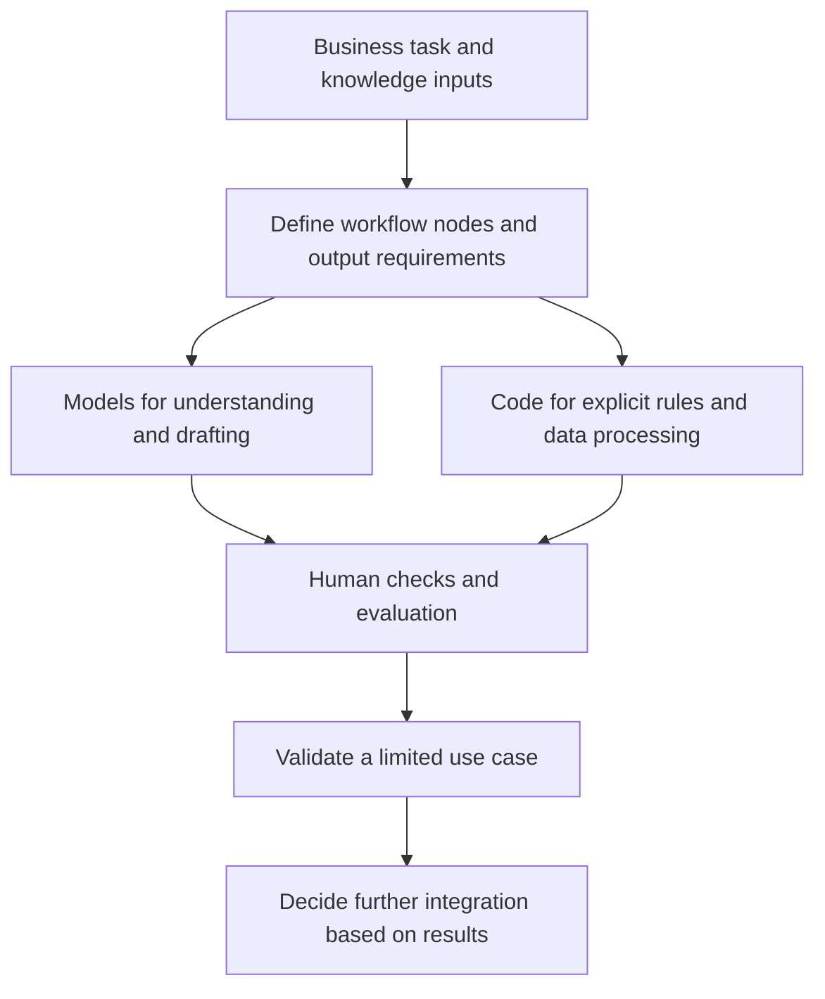

# Zhengye: Enterprise AI Use-Case Assessment and Technical Mentoring

**正晔网红财税：企业 AI 场景诊断与技术辅导**

**Contributor / 申请人：** Wang Zhaohua (Jiamu) / 王照华（甲木）

**My role / 本人角色：** AI use-case consultant, training-program designer and technical mentor / AI 场景顾问、培训方案设计者、技术指导者。

| Activity detail / 活动信息 | Evidence status / 依据与状态 |
| --- | --- |
| Needs discussion / 需求沟通 | 2026-02-25, approximately 51 minutes recorded in the meeting summary / 会议总结记录约 51 分钟，并非培训时长 |
| Planned training / 计划培训 | Detailed materials state 2026-03-13–14, approximately 80 staff; actual delivery dates and attendance pending / 完整大纲标注 3 月 13–14 日、约 80 人，实际交付日期和人数待核 |
| Original audience / 原活动范围 | Internal enterprise staff and the internal project lead / 企业内部员工与项目牵头人 |
| Fee nature / 收费性质 | Fee-bearing commercial service, according to retained agreement terms / 据留存合同课酬条款，为收费商业服务 |

## Activity description · English

I provided AI use-case assessment, training design and technical guidance for Zhengye's sales, content, client-service and delivery workflows. Through needs discussions, employee questionnaires and anonymized cases, I examined sales-knowledge reuse, recurring data collection and reporting, routine client replies and onboarding. I translated these needs into training cases and application paths. My guidance emphasized workflow decomposition, business knowledge and prompts, matching models or tools to tasks, and using deterministic code where appropriate. With the internal lead, I discussed existing agent demos, deployment choices and small-scale validation before further integration or investment. This helped frame business problems as technical tasks that could be tested progressively. These methods can inform AI ERP client-service and delivery workflows and Microsoft Foundry Agent tool use and evaluation.

## 活动说明 · 中文

我围绕正晔网红财税的销售、内容运营、客户服务与方案交付需求，开展 AI 场景诊断、培训方案设计和技术辅导。我通过需求沟通、员工问卷及脱敏业务案例，梳理销售经验难以复用、重复取数与汇报、客户常见问题答复和新人知识传递等任务，将其转化为培训案例与应用路径。技术指导重点是拆解工作流节点、组织业务知识与提示词、为不同任务匹配模型或工具，并明确哪些环节适合用确定性代码处理。我也与企业内部牵头人讨论现有智能体演示的问题、部署选型及小范围验证方法，建议先验证具体场景，再决定系统集成和进一步投入。我的工作帮助企业将业务问题表述为可以逐步验证的技术任务。这种知识沉淀、数据处理与工具编排思路，可为 AI ERP 的客户服务和交付流程，以及 Microsoft Foundry Agent 的工具调用与评估设计提供参考。

## My contribution · 个人贡献

- **Needs assessment / 需求诊断：** Connected recurring sales, content, reporting, client-service and onboarding tasks to possible AI use cases.
- **Training design / 培训设计：** Planned questionnaire and anonymized-case inputs, designed a two-day curriculum and prepared learning materials. The source action list attributes questionnaire, syllabus and resource tasks to 甲木.
- **Technical mentoring / 技术辅导：** Discussed task decomposition, prompt and knowledge organization, model/tool fit, deterministic code and limited pilots with the internal lead.

The narrative is the applicant's account. Source records support the discussion, contribution assignments and material preparation. The completed labels in an action list and a delivery label in the workspace index do not independently confirm attendance, exact teaching dates or implementation outcomes. Original questionnaire responses and later mentoring messages have not been independently verified for this public post.

活动说明来自申请人自述；原记录可支持需求讨论、个人待办归因和材料准备。待办“已完成”及项目索引“已交付”的标签不能独立证明现场人数、实际授课日或实施效果；本次尚未独立核对员工问卷原始结果及后续辅导消息。

## Supporting materials · 公开证据摘要

| Public attachment / 公开附件 | What it documents / 记录内容 |
| --- | --- |
| [Needs discussion and mentoring record / 需求沟通与技术辅导摘要](https://github.com/isjiamu/mvp-application-evidence/blob/main/evidence/zhengye/01-needs-and-mentoring-summary.md) | Meeting date, contribution locators, chapter markers and assigned actions / 会议日期、章节定位与个人待办 |
| [Training design and source inventory / 培训设计与原材料目录](https://github.com/isjiamu/mvp-application-evidence/blob/main/evidence/zhengye/02-training-design-and-materials.md) | Detailed syllabus, handbook and original deck locators; planned dates and scope / 完整课纲、手册及课件页码、计划日期与范围 |
| [Stage status, access and fees / 阶段状态、访问范围与收费](https://github.com/isjiamu/mvp-application-evidence/blob/main/evidence/zhengye/03-evidence-status-and-access.md) | Preparation vs delivery/validation, internal audience, commercial-service nature and evidence gaps / 准备、交付与验证状态，内部范围、收费性质与缺口 |

These are redacted summaries and a source inventory prepared for public review on 2026-10-12. The original meeting documents, slides, questionnaires, client cases and contractual/transaction records are retained privately. They are not independently certified public exhibits. The retained agreement includes restrictions on third-party sharing of materials, so originals are not uploaded here.

以上为 2026-10-12 整理的脱敏核验摘要与原材料目录，原始会议、课件、问卷、客户案例及合同交易材料保留本地；摘要不属于第三方认证的公开原始证据。留存合同含材料向第三方传播的限制，本帖未上传原件。

## Method illustration · 技术指导方法示意

The diagram summarizes the applicant's approach. It is not an actual client-workflow screenshot, learner outcome or deployed system.

下图仅依据活动说明概括方法，不代表客户实际流程、学员成果或已部署系统。

## Evidence still needed · 待补材料

1. **Actual schedule / 实际培训与辅导日程：** Dates, sessions and hours; February 25 is the needs-meeting date, and March 13–14 appears in planning materials.
2. **Actual participants / 实际受指导人数：** Attendance and role distribution; approximately 80 is the intended audience, not confirmed participation.
3. **Mentoring process / 本人指导过程：** Anonymized Q&A, workflow revisions or knowledge/prompt comparisons.
4. **Validated outcome / 阶段成果：** Separate delivered training, validated prototypes and later implementation; add one complete client-service, reporting or knowledge-reuse case.
5. **Approved visual evidence / 可公开图片：** No onsite photos were found in the searched project locations. The available company logo does not establish delivery. Client-approved photos, course excerpts or outcome screenshots can be added when cleared for public sharing.

**Technology relevance / 技术关联：** AI ERP and Microsoft Foundry references concern transferable methods. This post does not claim direct Foundry use, a Foundry deployment or measured business impact. The original enterprise activity was internal; this supporting-materials post is publicly readable without signing in.

AI ERP 与 Microsoft Foundry 的关联指方法迁移，不声称本项目直接使用或部署 Foundry，也不声称已测得业务成效。原活动为企业内部项目；本资料帖可免登录公开阅读。
